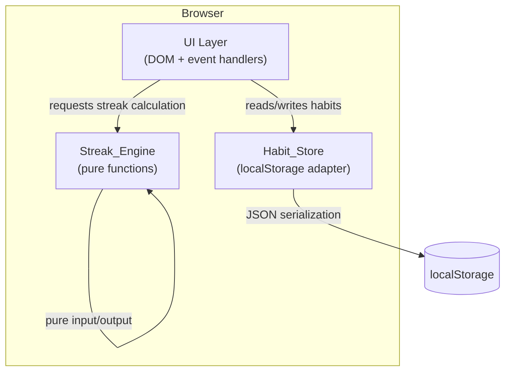

# Design Document

## Overview

The habit-streak-tracker is a vanilla HTML/CSS/JS single-page application (SPA) delivered as static files. There is no server, no build step, and no framework. The user opens `index.html` directly in a browser.

The app lets users add named habits, mark them complete each day, and watch a Duolingo-style streak counter grow. A **mercy window** of up to 2 consecutive missed days keeps the streak alive — only a gap of 3 or more days resets it to 0. All data is stored in `localStorage` so it survives page reloads and browser restarts.

**Key design drivers:**

- **Zero dependencies** — no npm, no bundler, no CDN libraries. Everything ships in three files (`index.html`, `style.css`, `app.js`).
- **Separation of concerns** — streak logic, storage, and DOM manipulation are in distinct modules within `app.js`, making each testable in isolation.
- **Deterministic streak math** — all date arithmetic is performed in the user's local timezone using `Date` objects, never UTC offsets, so midnight resets happen at the right wall-clock time.

---

## Architecture

The application is split into three logical layers that map directly to the glossary subsystems defined in requirements.



**Data flow on page load:**

1. `Habit_Store.load()` reads `localStorage` and deserializes all habits and completions.
2. `Streak_Engine.compute(habit, today)` recalculates each streak in memory.
3. The UI renders each habit card from the in-memory state.

**Data flow on habit completion:**

1. The user checks a checkbox.
2. The UI calls `Habit_Store.addCompletion(habitId, today)`.
3. The UI calls `Streak_Engine.compute(habit, today)` and updates the displayed count.
4. `Habit_Store.save()` persists the full state to `localStorage`.

**Daily reset detection:**

A lightweight `setInterval` (1-minute polling) compares the stored `lastSessionDate` against `todayString()`. When a date change is detected the UI re-renders all checkboxes without touching completion history.

---

## Components and Interfaces

### Module: `Habit_Store`

Responsible for all `localStorage` read/write operations. Exposes a synchronous API because `localStorage` is synchronous.

```js
// Internal storage key
const STORAGE_KEY = "habit_tracker_data";

Habit_Store = {
  load()           → HabitList | null,   // null = parse failure
  save(HabitList)  → { ok: boolean, error?: string },
  addHabit(name)   → Habit,
  deleteHabit(id)  → void,
  addCompletion(habitId, dateString) → void,
}
```

`HabitList` is serialized as a single JSON blob under `"habit_tracker_data"`. All inner keys are prefixed with `"habit_tracker_"` only at the `localStorage` key level (one top-level key).

### Module: `Streak_Engine`

A set of **pure functions** — no side effects, no DOM access, no `localStorage` access. All inputs come from the caller; all outputs are return values.

```js
Streak_Engine = {
  compute(completionDates: string[], today: string) → StreakResult,
  isActive(completionDates: string[], today: string) → boolean,
}

StreakResult = { count: number, isActive: boolean }
```

`completionDates` is an array of `"YYYY-MM-DD"` strings representing every day on which the habit was completed (deduplicated and sorted ascending before processing).

### Module: `UI`

Handles DOM queries, event binding, and rendering. Calls `Habit_Store` and `Streak_Engine`; never accesses `localStorage` directly.

```js
UI = {
  init()                   → void,   // called once on DOMContentLoaded
  renderHabitList()        → void,
  renderHabitCard(habit)   → HTMLElement,
  showValidationError(field, message) → void,
  clearValidationError(field)         → void,
  showToast(message, level)           → void,  // level: "info" | "warn" | "error"
}
```

### File structure

```
/Users/fauzanrhamzy/Desktop/revou-coding-camp/
├── index.html   ← markup skeleton + script/style references
├── style.css    ← layout, card styles, streak indicator, animations
└── app.js       ← Habit_Store, Streak_Engine, UI modules (IIFEs or ES modules)
```

---

## Data Models

### `Habit`

```ts
{
  id:          string,       // UUID v4 generated at creation time
  name:        string,       // trimmed, max 100 chars
  createdAt:   string,       // "YYYY-MM-DD"
  completions: string[],     // sorted array of "YYYY-MM-DD" strings, deduplicated
}
```

### `HabitList` (the root persistence object)

```ts
{
  habits:          Habit[],
  lastSessionDate: string,   // "YYYY-MM-DD" — used for daily reset detection
}
```

### `StreakResult`

```ts
{
  count:    number,   // ≥ 0
  isActive: boolean,
}
```

### Date string format

All dates are stored as `"YYYY-MM-DD"` strings computed from `new Date()` in the user's local timezone:

```js
function todayString() {
  const d = new Date();
  return `${d.getFullYear()}-${String(d.getMonth()+1).padStart(2,'0')}-${String(d.getDate()).padStart(2,'0')}`;
}
```

This avoids UTC drift when calling `.toISOString()`, which always returns UTC.

### Streak algorithm (reference implementation)

```
function compute(completionDates, today):
  if completionDates is empty → return { count: 0, isActive: false }

  dates = deduplicate(completionDates).sort ascending
  mostRecent = dates[last]

  if daysBetween(mostRecent, today) >= 3:
    return { count: 0, isActive: false }   // Broken streak

  // Walk backward from mostRecent, allowing gaps ≤ 2
  count = 1
  prev = mostRecent
  for each date in dates from second-to-last down to first:
    gap = daysBetween(date, prev)
    if gap == 0: continue              // duplicate (already deduped but safe)
    if gap <= 3: count += 1; prev = date   // gap of 1-2 is mercy; gap of 1 is normal
    else: break                            // gap ≥ 3 ends the unbroken run

  isActive = daysBetween(mostRecent, today) <= 2
  return { count, isActive }
```

> **Design decision — mercy window boundary:** The requirement states a gap of 1 or 2 days is a continuation; 3 or more breaks it. The algorithm above iterates backward through sorted completions and breaks the run on the first gap ≥ 3 days, ensuring the final `count` reflects only the current unbroken run.

---

## Correctness Properties

*A property is a characteristic or behavior that should hold true across all valid executions of a system — essentially, a formal statement about what the system should do. Properties serve as the bridge between human-readable specifications and machine-verifiable correctness guarantees.*

### Property 1: Whitespace habit names are rejected

*For any* string composed entirely of whitespace characters (including the empty string), attempting to add it as a habit name SHALL leave the habit list unchanged.

**Validates: Requirements 1.3**

---

### Property 2: Duplicate habit names are rejected (case-insensitive)

*For any* non-empty habit name that already exists in the habit list (compared case-insensitively after trimming), attempting to add a second habit with that name SHALL leave the habit list unchanged.

**Validates: Requirements 1.4**

---

### Property 3: Habit persistence round-trip

*For any* list of valid habits and their completion records, serializing the list to localStorage and then deserializing it SHALL produce a list equal to the original (same habits, same completion dates, same IDs).

**Validates: Requirements 5.1, 5.2**

---

### Property 4: Mercy window — gaps of 1 or 2 days do not break the streak

*For any* sequence of completion dates where every consecutive gap is at most 2 days, `Streak_Engine.compute` SHALL return a count equal to the number of distinct completion days in the sequence (the mercy days are not counted but do not reset the counter).

**Validates: Requirements 4.1, 4.2**

---

### Property 5: Gap of 3 or more days resets the streak

*For any* sequence of completion dates that contains at least one consecutive gap of 3 or more calendar days, `Streak_Engine.compute` SHALL return a count that reflects only the completion days in the most recent unbroken run after the gap, discarding all earlier completions.

**Validates: Requirements 4.3**

---

### Property 6: Active vs. Broken classification

*For any* non-empty completion list, `Streak_Engine.compute` SHALL classify the streak as Active if and only if the most recent completion date is 0, 1, or 2 calendar days before today; otherwise it SHALL classify it as Broken and return a count of 0.

**Validates: Requirements 4.4, 4.5**

---

### Property 7: Empty completion list returns zero streak

*For any* habit with no completion records, `Streak_Engine.compute` SHALL return `{ count: 0, isActive: false }`.

**Validates: Requirements 4.7**

---

### Property 8: Adding a completion grows the completion list

*For any* habit and any date on which no completion has been recorded, calling `Habit_Store.addCompletion(habitId, date)` SHALL result in that date appearing exactly once in the habit's completion array, with the array length increasing by exactly 1.

**Validates: Requirements 3.1**

---

### Property 9: Today's completion is idempotent

*For any* habit that has already been completed today, calling `Habit_Store.addCompletion(habitId, today)` again SHALL leave the completion array unchanged (no duplicates added, length unchanged).

**Validates: Requirements 3.3**

---

## Error Handling

| Failure scenario | Subsystem | Response |
|---|---|---|
| `localStorage` unavailable (private mode, quota exceeded, SecurityError) | `Habit_Store` | Returns `null` from `load()`; `save()` returns `{ ok: false, error }`. UI shows a non-blocking toast warning. |
| `localStorage` quota exceeded on save | `Habit_Store` | `save()` aborts the write, returns error. UI shows error toast; in-memory state is unchanged. Previous good state remains in `localStorage`. |
| Corrupt / unparseable JSON in `localStorage` | `Habit_Store` | `load()` catches the exception, returns `null`. UI initializes an empty list and shows a warning toast. |
| `addCompletion` fails | `Habit_Store` | Returns `{ ok: false }`. UI leaves the checkbox unchecked and shows an error toast. |
| Deletion `localStorage` write fails | `Habit_Store` | Returns `{ ok: false }`. UI retains the habit card and shows an error toast. |
| Date parsing error (clock skew, bad stored date) | `Streak_Engine` | `compute()` skips unparseable date strings and continues with valid ones. |

All user-visible errors are displayed via a `showToast()` call. Toasts auto-dismiss after 4 seconds. Critical errors (data loss risk) use `level: "error"` (red); warnings use `level: "warn"` (amber).

---

## Testing Strategy

### Unit / Example tests

Verify specific behaviors with concrete inputs using a minimal test harness (no external library required — a simple `assert` wrapper is sufficient for a vanilla JS project).

Recommended areas:

- `Streak_Engine.compute` with hand-crafted completion sequences covering: consecutive days, 1-day gap, 2-day gap, 3-day gap, mixed gaps, single completion, empty array.
- `Habit_Store.load` / `save` round-trip with valid data.
- `Habit_Store.load` with corrupt JSON (expects `null`).
- Input validation: empty string, whitespace-only, >100 chars, duplicate name (case variants).
- Daily reset: `lastSessionDate` from yesterday triggers re-render, from today does not.

### Property-based tests

The project is vanilla JS so the recommended PBT library is **[fast-check](https://fast-check.dev/)** (browser-compatible, no build step needed via CDN or a single `<script>` tag in the test HTML).

Each property test must run a **minimum of 100 iterations**.

Tag format for each test: `// Feature: habit-streak-tracker, Property N: <property_text>`

| Property | Generator strategy | fast-check arbitraries |
|---|---|---|
| P1: Whitespace names rejected | Generate strings of `\t`, `\n`, ` ` | `fc.stringOf(fc.constantFrom(' ','\t','\n'))` |
| P2: Duplicate names rejected | Generate a name, add it, then try to add same name with case variants | `fc.string()` + `.toLowerCase()` / `.toUpperCase()` |
| P3: Persistence round-trip | Generate arrays of habits with completion arrays | `fc.array(habitArbitrary)` |
| P4: Mercy window continuations | Generate completion sequences with gaps ≤ 2 days | Custom arbitrary building date arrays with max gap 2 |
| P5: 3-day gap resets streak | Generate sequences with at least one gap ≥ 3 days | Custom arbitrary injecting a 3+ day gap |
| P6: Active/Broken classification | Generate (completions, today) pairs | `fc.tuple(fc.array(...), fc.date())` |
| P7: Empty list returns 0 | Constant | `fc.constant([])` |
| P8: Completion grows array | Generate (habit, date not in completions) | `fc.record(...)` + `fc.date()` with filter |
| P9: Duplicate completion is idempotent | Generate (habit, date already in completions) | `fc.record(...)` with `.map(addOneCompletion)` |

### Integration smoke tests

- Page loads and displays empty-state message when `localStorage` is cleared.
- Page loads and restores habits after a simulated reload (write to `localStorage`, reload, assert cards render).
- Midnight rollover: mock `Date` to advance past midnight, trigger the interval, assert checkboxes reset.

### Manual acceptance checklist

- Add habit → appears in list → reload → still present.
- Complete habit → streak = 1 → next day (mocked) → streak = 2.
- Skip 2 days → streak still shows (mercy) → skip 3 days → streak = 0.
- Delete habit → confirmation prompt → cancel → habit remains → confirm → habit gone.
- Fill `localStorage` to quota → error toast appears.
